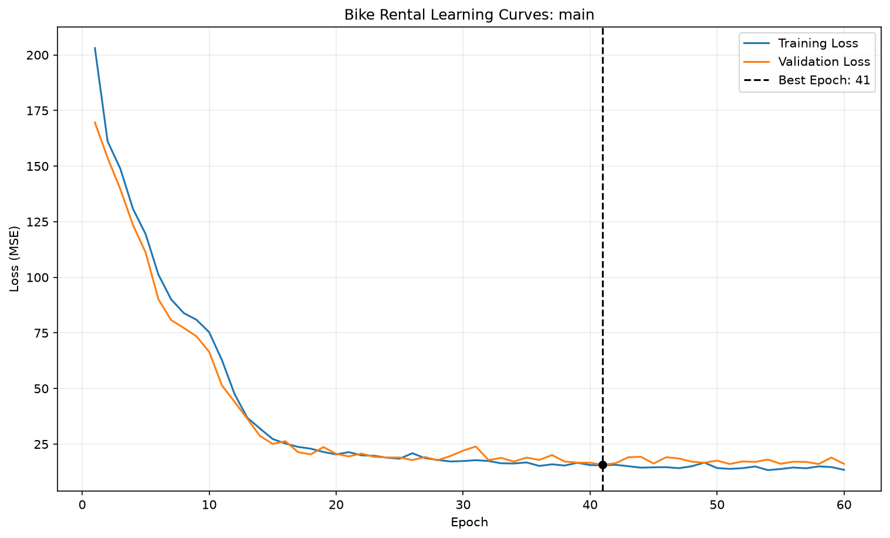
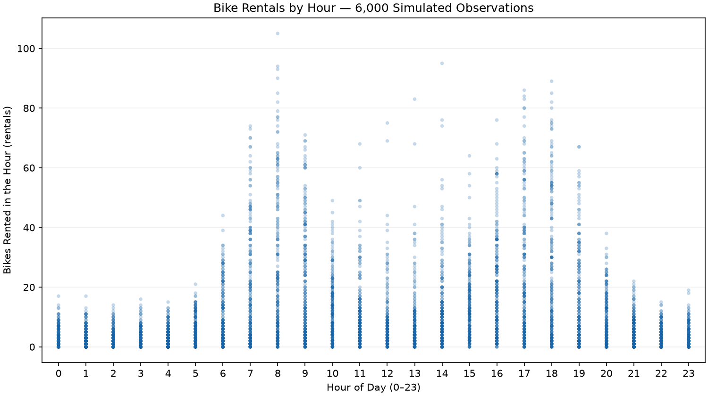
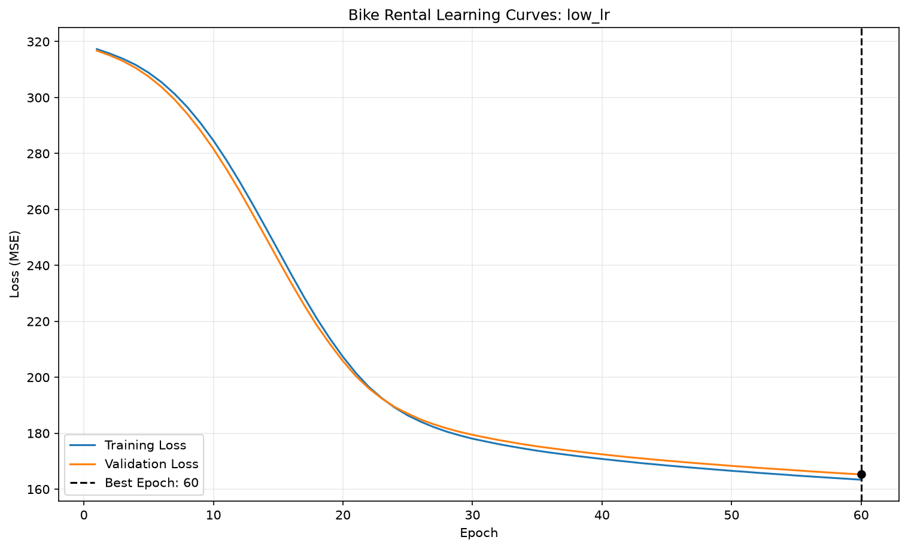
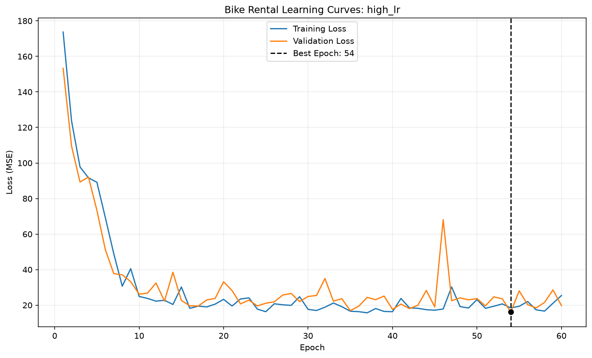

# Lakeshore Bike Demand

## What it does

This project uses a PyTorch neural network to predict hourly bike rentals based on time, weather, weekend status, and station type. It compares the neural network with two baselines—training mean and linear regression—to evaluate its predictive performance.

## How to run it

Create and activate the Conda environment:

```bash
conda env create -f environment.yml
conda activate lab07-first-principles
```

Run the project to reproduce the results:

**Windows (PowerShell)**

```powershell
python train.py
$LASTEXITCODE
```

**Linux / macOS (Bash or Zsh)**

```bash
python train.py
echo $?
```

An exit code of `0` indicates successful execution.

Run the code quality checks and tests:

```bash
python -m ruff format --check .
python -m ruff check .
python -m pytest
```

## Data and split

The dataset contains 6,000 synthetic bike rental records, split into 60% training (3,600), 20% validation (1,200), and 20% test (1,200) using seed 2026.

Numerical features are standardized with StandardScaler, and categorical features are encoded with OneHotEncoder. Both are fitted only on training data, then applied to validation and test data without refitting to prevent data leakage.

```python
preprocessor = make_preprocessor(training_rows[FEATURES])
```

Training data is used for learning, validation data for model selection, and test data for final evaluation.

## Model and training

The PyTorch neural network has two hidden layers (32 and 16 neurons) with ReLU activation and a single output without an output activation function.

The model was trained for 60 epochs using MSE loss, the Adam optimizer (learning rate 0.01), and a batch size of 64. Seed 2026 was used for data generation and splitting, PyTorch initialization, and the DataLoader generator.

**Core training loop (excerpt)**

```python
optimizer.zero_grad()
predictions = model(features)
loss = loss_function(predictions, targets)
loss.backward()
optimizer.step()
```

Training and validation losses were recorded each epoch, and the weights from the lowest validation MSE (epoch 41) were restored.

## Results

The neural network achieved the lowest MAE on both validation and test data, outperforming the two baselines.

| Model              | Validation MAE | Test MAE   |
| ------------------ | -------------- | ---------- |
| Training Mean      | 9.9519         | 9.8484     |
| Linear Regression  | 9.0322         | 8.7630     |
| **Neural Network** | **2.6393**     | **2.6122** |

*MAE is measured in bike rentals. Lower values indicate better predictions.*

The neural network's test MAE (2.6122) was close to its validation MAE (2.6393), indicating consistent performance on the held-out test data.

### Learning curves



Training and validation losses decreased substantially, with the lowest validation MSE at epoch 41.

### Hourly rental patterns



The plot shows nonlinear rental patterns, with higher demand around morning and evening commuting hours. Linear regression cannot fully capture these patterns using a straight-line relationship, which helps explain its higher prediction error.

## Experiments

### Initial training checks

The network was first trained on a single batch for 500 steps to verify that the loss decreased substantially. Additional 5-epoch and 30-epoch runs were performed to check the training loop and best-weight restoration.

### Learning rate experiments

Three runs were conducted for 60 epochs, changing only the learning rate while keeping the network architecture (32, 16), batch size (64), and other settings unchanged.

| Run      | Learning Rate | Best Epoch | Best Validation MSE | Validation MAE at Best Epoch | Final Training Loss | Final Validation Loss |
| -------- | ------------- | ---------- | ------------------- | ---------------------------- | ------------------- | --------------------- |
| **Main** | 0.01          | 41         | **15.7008**         | **2.6393**                  | 13.4478             | 16.1183               |
| low_lr   | 0.0001        | 60         | 165.2811            | 8.7809                      | 163.3875            | 165.2811              |
| high_lr  | 0.1           | 54         | 16.0723             | 2.7870                      | 25.4027             | 19.7588               |

Best epochs were selected using the lowest validation MSE. The reported validation MAE corresponds to each selected epoch, ensuring a consistent selection criterion across all runs.

All losses in the table are MSE. Final Training Loss and Final Validation Loss are the values from epoch 60, whereas the best-epoch MSE and MAE come from the selected epoch.

**Main — Relatively stable learning**

Both training and validation losses decreased substantially, with the lowest validation MSE at epoch 41. Validation loss fluctuated after epoch 41 and ended slightly above its minimum, suggesting possible mild overfitting, but no severe divergence was observed.

**low_lr — Underfitting**

Training and validation losses decreased gradually but remained high throughout the 60 epochs. This indicates that the small learning rate did not allow sufficient learning within the available epochs.

**high_lr — Unstable learning**

The validation loss showed larger fluctuations and sharp spikes during training, indicating unstable optimization at the higher learning rate.

### Additional learning curves

**Low learning rate (0.0001)**



**High learning rate (0.1)**



### Additional validation

The training loop was tested by deliberately disabling gradient clearing and optimizer updates to confirm that failures could be detected. Best-weight restoration was verified using controlled validation losses.

## Limitations

The dataset is synthetic and does not account for factors such as holidays, special events, or unexpected disruptions.

Although the neural network performed well on the held-out test data, its performance on real-world data remains unverified. Therefore, planners should not rely solely on these predictions for bike redistribution decisions.

Linear regression produced negative predictions on the validation set (minimum −13.13 rentals), which are unrealistic. Predictions were evaluated without clipping or rounding. Adding nonlinear features might improve its performance, but this was not tested.
